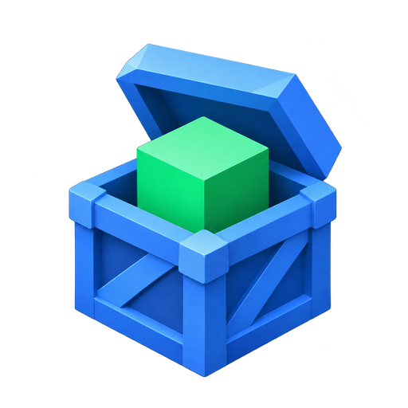
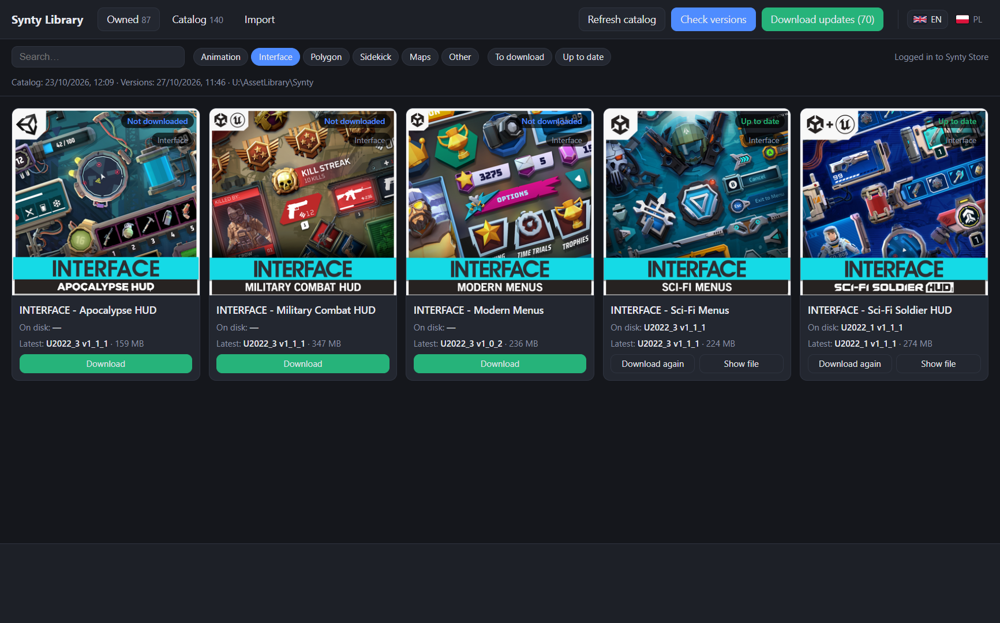

<p align="center">
  
</p>

<h1 align="center">Synty Library</h1>

<p align="center">
  A desktop app that keeps a local copy of your <a href="https://syntystore.com">Synty Store</a> purchases up to date.
</p>

<p align="center">
  
  
  
  
  <a href="https://github.com/Shlizer/synty_sync/releases/latest"></a>
</p>

<p align="center">
  
</p>

---

If you own dozens of Synty packs, finding out which ones got updated (and for which Unity version) means clicking through every order on the store. Synty Library does that for you: it reads your purchase library, compares it with the `.unitypackage` files on your disk, and downloads only what is missing or outdated, sorted into neat category folders.

## Features

- **Owned packs view** - every pack you bought, with the version on disk, the latest version on the store and a clear status badge.
- **One-click updates** - download all missing and outdated packs in one go, with a progress bar and a cancel button. Old files are replaced only after the new download completes.
- **Smart version picking** - always chooses the file for the newest Unity editor, then the newest pack version (handles `Unity_2021_3`, `Unity_6`, `v1_1_3`, `v1.01` and other naming schemes).
- **Full catalog** - browse all Synty packs (Polygon, Interface, Animation, Sidekick, Maps) with icons, filtered by owned / not owned.
- **Import existing files** - already have a folder full of `.unitypackage` files? The importer matches them to your purchases (including old file names such as `POLYGON - Dark Fantasy - Low Poly 3D Art by Synty v1.01`) and moves them into the library.
- **Search and filters** - by name, category and status.
- **English and Polish UI** - switch languages with a click; the choice is remembered.
- **Polite to the store** - limited parallelism and automatic retry with back-off on rate limiting (HTTP 429).

### Pack statuses

| Status | Meaning |
| --- | --- |
| Up to date | The local file matches the latest version. |
| Newer version | The store has a newer version of the pack. |
| Newer Unity | The same pack is now available for a newer Unity editor. |
| Not downloaded | You own the pack, but there is no local file yet. |
| No Unity file | The purchase has no Unity download (e.g. Unreal-only). |
| Unknown | A local file exists, but the pack is no longer listed in your library. |

## Requirements

- Windows 10 or 11 (macOS and Linux are not tested)
- A Synty Store account with purchased packs
- [Node.js](https://nodejs.org/) 20 or newer - only to run from source or build

## Download

Grab the latest version from the [Releases](https://github.com/Shlizer/synty_sync/releases/latest) page:

- `Synty-Library-Setup-<version>.exe` - installer
- `Synty-Library-<version>-win-x64.zip` - portable, unzip and run `Synty Library.exe`

The app is not code-signed, so Windows SmartScreen may show a warning on first launch. Choose **More info -> Run anyway**.

## Running from source

```bash
git clone https://github.com/Shlizer/synty_sync.git
cd synty_sync
npm install
npm start
```

### Building a standalone app

```bash
npx electron-builder
```

The app is written to `dist/win-unpacked/Synty Library.exe`. To build the same installer and zip as a release, run `npx electron-builder --win nsis zip`.

## Usage

1. **Refresh catalog** - fetches the public pack list and icons from the store.
2. **Check versions** - reads your purchase library. The first time, a Synty Store login window opens; after you sign in, the session is kept and refreshed silently.
3. **Download updates** - downloads every pack marked as *Not downloaded*, *Newer version* or *Newer Unity*. Single packs can be downloaded from their cards.
4. **Import** *(optional)* - scans the import folders and the library for existing `.unitypackage` files, shows what they match, and moves the selected ones into place.

Clicking a pack image opens its page on the store.

### Library layout

```
<library root>/
|-- library.json        # catalog, owned packs and local file info
|-- icons/              # pack thumbnails
|-- Animation/
|-- Interface/
|-- Maps/
|-- Polygon/
|-- Sidekick/
`-- Other/              # Mini, Simple and anything uncategorized
```

## Configuration

Settings are stored in `%APPDATA%\Synty Library\settings.json`:

```json
{
  "root": "D:\\Assets\\Synty",
  "importDirs": ["D:\\Downloads\\Synty"],
  "lang": "en"
}
```

| Key | Description |
| --- | --- |
| `root` | Library folder where packs, icons and `library.json` are kept. |
| `importDirs` | Extra folders scanned by the importer. |
| `lang` | UI language (`en` or `pl`). When missing, the system language is used. |

By default `root` is `Documents\Synty` and `importDirs` is empty. The library folder can be changed in the app; `importDirs` only in this file.

## How it works

- **Catalog** - the store's public Shopify endpoint (`/products.json`) provides titles, categories and images.
- **Purchases** - the downloads area (`syntystore.com/apps/downloads`) is HTML behind a login. The store takes over the account session only through SSO redirects during real navigation, so the app opens it in a (normally hidden) Electron window and then reads the pages with the same session.
- **Downloads** - files are streamed to a `.part` file, checked against `Content-Length` and only then renamed over the previous version.
- **State** - everything is kept in `library.json` (written atomically), so the library can be moved or backed up together with the files.

## Privacy

- The app never sees or stores your password. You log in on the store's own page, and the session cookies live in a local Electron profile (`persist:synty`).
- Network traffic goes only to Synty Store (`syntystore.com`, its Shopify login pages and CDN).
- No telemetry.

## Development

```
main.js            Electron main process, IPC, store session handling
preload.js         API exposed to the renderer
lib/
  catalog.js       public catalog + icons
  owned.js         purchase library scraping
  download.js      streaming downloads
  importLocal.js   matching existing .unitypackage files
  pick.js          version parsing and comparison
  store.js         library.json persistence
  http.js          fetch with retry
  i18n.js          translations (shared by main and renderer)
renderer/          UI (plain HTML/CSS/JS, no framework)
```

### Debug switches

| Variable | Effect |
| --- | --- |
| `SYNTY_CHECK=1` | Headless run: checks versions, prints the result and the import scan to the console, then quits. |
| `SYNTY_DOWNLOAD=<key>` | With `SYNTY_CHECK`, also downloads one pack. |
| `SYNTY_SHOT=<prefix>` | Opens the UI, saves `<prefix>-catalog.png`, `-owned.png` and `-import.png`, then quits. |
| `SYNTY_LANG=en\|pl` | With `SYNTY_SHOT`, forces the UI language (not saved). |
| `SYNTY_TRACE=1` | Logs store navigation URLs. |

> Starting Electron from a VS Code terminal? VS Code may set `ELECTRON_RUN_AS_NODE`, which makes Electron run as plain Node. Unset it first.

### Adding a language

1. Add an entry to `LANGUAGES` and a string table to `STRINGS` in [`lib/i18n.js`](lib/i18n.js). Plural forms use `Intl.PluralRules` categories (`one`, `few`, `many`, `other`).
2. Add a flag as `renderer/flags/<code>.svg`.

## Disclaimer

This is an unofficial, personal project. It is not affiliated with, endorsed by or supported by Synty Studios. It only downloads packs you have purchased, using your own account, and does the same thing you would do by hand in the store's download section. Please respect the Synty Store license terms. All Synty names, artwork and trademarks belong to Synty Studios.

## Contributing

Bug reports and pull requests are welcome - please read [CONTRIBUTING.md](CONTRIBUTING.md) first.

## License

[ISC](https://opensource.org/license/isc-license-txt)

## AI disclosure

AI tools were used during development - for writing code, debugging and troubleshooting, translations and documentation. All code was reviewed by the author.
